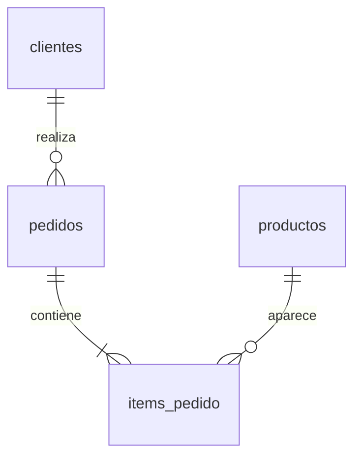

# 01 · Aurora PostgreSQL y nuestros primeros datos

Al terminar vas a tener una base privada con cuatro tablas de una tienda,
datos cargados y consultas funcionando desde AWS CLI. Más adelante DMS va a
leer esta misma base.

## Qué vamos a crear

| Recurso | Para qué sirve |
| --- | --- |
| VPC y dos subnets privadas | Alojar la base en dos zonas disponibles. |
| Aurora PostgreSQL 16.13 | Guardar los datos transaccionales. |
| Una instancia Serverless v2 | Ejecutar las consultas, entre 0,5 y 2 ACU. |
| Credencial administrada por RDS | Generar y rotar la contraseña en Secrets Manager. |
| Data API | Ejecutar SQL por HTTPS desde la CLI, usando el perfil ya autenticado. |
| Grupo de parámetros | Activar replicación lógica para CDC y exigir SSL. |
| Grupo de logs | Conservar los logs PostgreSQL durante 7 días. |

La guía usa **`us-east-1`**. No necesitás instalar `psql`, Docker ni abrir el puerto
5432 a Internet. Tampoco creamos un bastión, NAT gateway ni una instancia DMS en
esta etapa. La instancia única es una simplificación del laboratorio, no una
configuración de alta disponibilidad para producción.

**Aurora consume capacidad incluso sin consultas:** el mínimo es 0,5 ACU, no cero.
También hay consumo de almacenamiento, secretos y logs. Los créditos no son un
límite automático de gasto. Al terminar, seguí la limpieza de esta guía.

## 1. Confirmar cuenta y preparar Terraform

Desde la raíz del repositorio:

```sh
aws sts get-caller-identity --profile workshop
terraform version
```

Necesitás Terraform **1.7 o posterior**. El repositorio fija el provider AWS 6.70
y conserva `.terraform.lock.hcl` para repetir la misma selección.

Copiá `infra/01-aurora/terraform.tfvars.example` como `infra/01-aurora/terraform.tfvars` y reemplazá
`expected_account_id` por el campo `Account` que devolvió la CLI. Si usás otro
perfil, cambiá `aws_profile` y los `--profile workshop` de los comandos de la guía.
El archivo de variables está excluido de Git.

```sh
terraform -chdir=infra/01-aurora init
terraform -chdir=infra/01-aurora plan
```

`init` descarga el provider; `plan` consulta AWS y muestra qué crearía. Todavía no
crea la base. Revisá los recursos con prefijo `utn-dms`. El provider rechaza una
cuenta distinta de `expected_account_id`.

Esta etapa usa el stack **`infra/01-aurora/`**, con su propio estado Terraform.
Incluye Aurora y la red necesaria para alojarla. Las siguientes etapas tendrán
sus propias carpetas y estados, y consumirán los outputs que necesiten de este
stack. Conservá su estado y la base mientras avanzás por el workshop.

## 2. Crear y reconocer los recursos

```sh
terraform -chdir=infra/01-aurora apply
```

Revisá el plan y confirmá con `yes`. La creación puede demorar varios minutos.
Esperá a que termine antes de ejecutar SQL.

En la consola, elegí la misma cuenta y región:

1. En **VPC**, ubicá `utn-dms` y sus dos subnets privadas.
2. En **RDS → Databases**, ubicá `utn-dms-aurora` y su writer. Observá el motor,
   el endpoint, la capacidad Serverless y que el acceso público esté deshabilitado.
3. En la configuración del cluster, ubicá el usuario `workshop_admin`, el secreto
   administrado por RDS y Data API habilitada. No hace falta revelar la contraseña.
4. En el grupo de parámetros, buscá `rds.logical_replication` y `rds.force_ssl`.
   Ambos tienen valor `1`. Verificá que el grupo figure aplicado (`in-sync`).
   Aurora no expone `rds.force_ssl` mediante `current_setting`; su valor se revisa
   en el grupo de parámetros de RDS.

Tu identidad IAM y `workshop_admin` son cosas diferentes. IAM autoriza la llamada
a Data API; el servicio usa la credencial de Secrets Manager para conectarse como
usuario PostgreSQL. Terraform conoce el ARN del secreto, pero no su contraseña.
El usuario específico de replicación se configura en la [etapa de DMS](03-dms.md).
Su regla de acceso de red se administra desde ese stack, sin reglas inline de
ingreso en el security group de Aurora para evitar conflictos entre estados.

## 3. Preparar la conexión de la CLI

Guardá la salida `data_api_request` en `.local/aurora.json`. Solo contiene el ARN
del cluster, el ARN del secreto y el nombre de la base; no contiene una contraseña.

**macOS o Linux:**

```sh
export AWS_CLI_FILE_ENCODING=UTF-8
mkdir -p .local
terraform -chdir=infra/01-aurora output -raw data_api_request > .local/aurora.json
```

**Windows · PowerShell:**

```powershell
$env:AWS_CLI_FILE_ENCODING = "UTF-8"
New-Item -ItemType Directory -Force .local | Out-Null
terraform -chdir=infra/01-aurora output -raw data_api_request | Set-Content -Encoding ascii .local/aurora.json
```

En los próximos comandos, `--cli-input-json` aporta esos tres datos y `--sql`
aporta la sentencia a ejecutar. Podés abrir los archivos SQL antes de enviarlos.
La codificación UTF-8 conserva los acentos de los datos en todos los sistemas.
El perfil necesita permisos `rds-data:ExecuteStatement` para el cluster y
`secretsmanager:GetSecretValue` para su secreto. Si la cuenta usa una clave KMS
propia, también necesita el permiso de descifrado correspondiente.

## 4. Crear las tablas

Abrí [`sql/01-schema.sql`](../sql/01-schema.sql). Las tablas quedan dentro del
schema `tienda`:



Todas tienen clave primaria: después podremos identificar qué fila fue insertada,
actualizada o eliminada. Los importes usan `numeric(12,2)` y las fechas incluyen
zona horaria.

```sh
aws rds-data execute-statement --profile workshop --region us-east-1 --cli-input-json file://.local/aurora.json --sql file://sql/01-schema.sql
```

El archivo es un único bloque `DO`: PostgreSQL ejecuta todo el bloque dentro de
una transacción. Data API no admite varias sentencias independientes en una sola
llamada. Una respuesta con `numberOfRecordsUpdated: 0` es normal para este bloque;
no es un conteo de las tablas creadas.

## 5. Cargar y consultar

Abrí [`sql/02-datos.sql`](../sql/02-datos.sql) y después ejecutá:

```sh
aws rds-data execute-statement --profile workshop --region us-east-1 --cli-input-json file://.local/aurora.json --sql file://sql/02-datos.sql
aws rds-data execute-statement --profile workshop --region us-east-1 --cli-input-json file://.local/aurora.json --sql file://sql/03-explorar.sql --format-records-as JSON --query formattedRecords --output text
```

La consulta devuelve ocho pedidos. Por ejemplo, el pedido `1001` de Ada suma
`63000.00` y el `1003` de Cata suma `76000.00`. Son importes por pedido, incluidos
los pendientes y cancelados; no una medida de ventas cobradas.

Los datos son ficticios. Las fechas fijas permiten comparar resultados entre
participantes; todavía no representan particiones de S3. La carga inicial agrega
IDs ausentes y no sobrescribe filas existentes. **No vuelvas a ejecutar la carga
durante CDC:** restauraría filas de ejemplo que hayas eliminado.

Para listar las tablas, también podés escribir SQL directamente:

```sh
aws rds-data execute-statement --profile workshop --region us-east-1 --cli-input-json file://.local/aurora.json --sql "SELECT table_name FROM information_schema.tables WHERE table_schema = 'tienda' ORDER BY table_name" --format-records-as JSON --query formattedRecords --output text
```

## 6. Comprobar el punto de partida

```sh
aws rds-data execute-statement --profile workshop --region us-east-1 --cli-input-json file://.local/aurora.json --sql file://sql/04-verificar.sql --format-records-as JSON --query formattedRecords --output text
```

Esperamos base `workshop`, usuario `workshop_admin`, replicación lógica en
`on` o `1`, `wal_level` en `logical`, y estos conteos. SSL obligatorio se comprueba
en el grupo de parámetros de RDS, con `rds.force_ssl=1` y estado `in-sync`:

| Tabla | Filas |
| --- | ---: |
| clientes | 5 |
| productos | 6 |
| pedidos | 8 |
| items_pedido | 12 |

Este resultado confirma el origen para continuar. Todavía no hay una tarea DMS,
replication slots ni datos replicados a S3. No generes los cambios del ejercicio
CDC hasta que la tarea esté lista.

## Si algo falla

- **Cuenta incorrecta en Terraform:** corregí el perfil o el ID esperado; no
  elimines la comprobación de cuenta para sortear el error.
- **Sesión vencida / no credentials:** renová el acceso siguiendo la
  [guía de preparación](https://utn.almorgan.dev/), conservando el mismo perfil.
- **AccessDenied en Data API:** comprobá permisos tanto sobre el cluster como
  sobre el secreto. Tener permiso de `sts:GetCallerIdentity` no alcanza.
- **HttpEndpointNotEnabled:** comprobá que `apply` terminó, que estás en la región
  correcta y que `.local/aurora.json` corresponde a este cluster.
- **DatabaseUnavailable / DatabaseResuming:** esperá a que el writer esté
  disponible. Esta configuración no usa auto-pausa; revisá también si el cluster
  fue detenido manualmente.
- **Versión o clase no disponible:** esta combinación se consultó en `us-east-1`.
  Otras regiones pueden requerir una versión 16.x distinta compatible con Data API.
- **Replicación lógica desactivada:** revisá si el writer tiene cambios de
  parámetros pendientes de reinicio. No avances a CDC hasta ver `logical`.
- **Tabla ya existente con otra estructura:** `IF NOT EXISTS` no migra esquemas.
  No reutilices una base ajena al taller para estos ejercicios.

## Limpieza

Si vas a continuar ahora con S3 y DMS, conservá la base. Si terminaste la sesión:

```sh
terraform -chdir=infra/01-aurora plan -destroy
terraform -chdir=infra/01-aurora destroy
```

**La limpieza borra los datos del laboratorio y no crea un snapshot final.**
Revisá el plan y confirmá únicamente los recursos de este workshop. RDS elimina
también el secreto administrado al eliminar el cluster. Si agregaste recursos
fuera de Terraform, revisalos por separado. Conservá el estado hasta completar
la limpieza y verificá en la consola que cluster y writer ya no existan.

Cuando existan stacks posteriores que dependan de esta VPC o de Aurora, eliminá
primero esos stacks. La limpieza de `01-aurora` queda al final del recorrido.

## Referencias

- [Aurora Serverless v2 y Data API](https://docs.aws.amazon.com/AmazonRDS/latest/AuroraUserGuide/data-api.html).
- [Replicación lógica en Aurora PostgreSQL](https://docs.aws.amazon.com/AmazonRDS/latest/AuroraUserGuide/AuroraPostgreSQL.Replication.Logical.Configure.html).
- [PostgreSQL como origen de DMS](https://docs.aws.amazon.com/dms/latest/userguide/CHAP_Source.PostgreSQL.html).
- [Limitaciones y errores de Data API](https://docs.aws.amazon.com/AmazonRDS/latest/AuroraUserGuide/data-api.troubleshooting.html).
- [Contraseñas de Aurora administradas por RDS](https://docs.aws.amazon.com/AmazonRDS/latest/AuroraUserGuide/rds-secrets-manager.html).

## Query Editor de la consola (opcional)

Está en **Amazon RDS/Aurora**, no en DMS. En RDS → Databases, seleccioná el cluster
y buscá Actions → Query. Requiere Data API habilitada. La conexión inicial de la
consola puede pedir credenciales y crear un secreto propio `rds-db-credentials/*`;
no asumimos que reutiliza automáticamente el secreto administrado de este taller.
El recorrido probado usa AWS CLI + Data API con el ARN del secreto existente, sin
mostrar la contraseña. Si creás una conexión adicional en la consola, registrá
su secreto en tu inventario y eliminá solo ese secreto al cerrar; el asistente
no borra secretos que no creó el laboratorio.

[Documentación del Query Editor](https://docs.aws.amazon.com/AmazonRDS/latest/AuroraUserGuide/query-editor.html).

## Cierre del recorrido completo

Si también desplegaste full load, CDC o Athena, usá [07 · Limpieza](07-limpieza.md)
para eliminar los seis stacks en orden y verificar recursos generados. Las
instrucciones de limpieza de esta etapa sirven para un recorrido parcial.

## Ritmo de la clase

Reservá varios minutos para crear el writer. En el ensayo de este recorrido tardó
alrededor de ocho minutos; no es un tiempo garantizado. Mientras Terraform espera,
podés recorrer VPC, subnets, security groups y parámetros del cluster en la consola.
